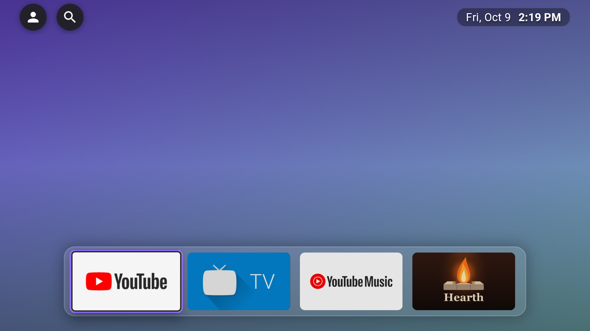
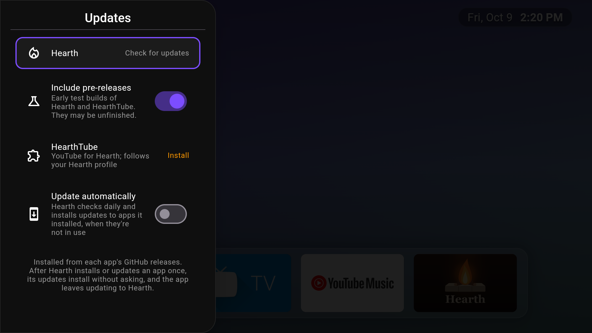

<p align="center">
  
</p>

<h1 align="center">Hearth</h1>

<p align="center">
  An ad-free home screen for Google TV that keeps everyone's profile and kids' limits working.
</p>

<p align="center">
  <a href="https://github.com/theSiegs/Hearth/releases/latest"></a>
  <a href="LICENSE"></a>
</p>

> [!WARNING]
> **Early development.** Hearth is built and tested on one Google TV device. Expect rough edges and breaking
> changes between versions. Not ready for general use yet.

<p align="center">
  
  
</p>

## Why Hearth

Google TV's home is mostly ads and "for you" rows. Other launchers remove them, but they also lose what makes
Google TV work for a family: each person's profile, kids profiles, and Family Link's bedtime and screen time.

Hearth keeps all of that:

- **Everyone gets their own home.** Hearth follows Google TV's profiles: each has its own apps, wallpaper and
  Continue Watching, and Netflix, Disney+ and others open on the right profile.
- **Kids stay in their limits.** Family Link's bedtime and time's-up screens still show, kids can't undo your setup
  without the parent PIN, and YouTube runs in HearthTube with a daily time limit.
- **Private by default.** No ads, analytics or account. Hearth talks only to the few services listed under
  [Privacy](#privacy), and to your Home Assistant if you have one.

It's free software (GPL-3.0).

## Features

**Profiles**
- Follows Google TV's own profiles, kids' and adults': a home layout, wallpaper and Continue Watching per person.
- **Profile Pairing** (optional): opening Netflix, Disney+, Apple TV, HBO Max or Paramount+ from Hearth picks your
  profile in that app, by name or the one you pair it with.
- **Lock Profile** with Google TV's own lock: hold the profile button (on remotes that have one), from Settings, or
  when the TV goes to sleep.

**Kids & Family Link**
- Works with Family Link: Hearth steps aside for Google TV's bedtime and time's-up screens, and comes back after.
- Hearth (and HearthTube) goes on each kids profile and stays there. **Settings → Profiles → Kids profiles**
  shows each kid as Ready or Needs a fix, and holds each kid's settings, like their YouTube time per day.
- A parent PIN guards anything in a kids profile that could undo your setup.
- With HearthTube, kids watch YouTube only there, where their daily time applies.

**A calm home screen**
- Wallpaper first: Bing's photo of the day, your own pictures, a gradient or black, per profile.
- A Favorites dock, **Continue Watching** with cover art (including shows from apps that don't use Google's list),
  and your apps in rows or grids.
- A top bar with the time and your Google calendars, and the weather (Open-Meteo, or the Breezy Weather app).
- **Search** for a film or show and see where it streams (US availability data); it opens in Netflix, Apple TV,
  HBO Max or Paramount+ directly, other services through Google TV's title page.

**The remote**
- Remap any spare button (press and hold) to an app, a TV input, a profile switch or lock, search or sleep.
- The Home button opens Hearth, every time.

**Also:** a notifications panel, sleep when idle, TV inputs (on TVs that have them), daily backups on the TV,
updates from GitHub releases, and 14 languages (most machine-translated; corrections welcome). If you ever want
Google TV's home back for a while, **Settings → TV & power → Use Google TV's home**.

## With Home Assistant

Hearth works fully without Home Assistant. If you have it, each side gets more from the other. Everything stays on
your home network, and each part is set up separately in **Settings → Home Assistant**
([details](docs/home-assistant.md)).

**What Hearth gains**
- **Pop-ups over any app**: the doorbell with a live camera view, the washer being done, a reminder, with buttons
  that act (unlock the door, turn on the porch light).
- **A dashboard one press away** (Right at the right edge of the home), drawn by Hearth so every control works with
  the remote: lights, climate, covers, media, cameras, and people on a map. Each profile can have its own dashboard,
  or none.
- **Remote buttons that run Home Assistant**: a scene, a script, a button or a toggle, on a press or a hold.
- **Approve from your phone**: a switch into your PIN-locked profile asks your phone first (see below).
- **A YouTube allowance shared across devices**: Home Assistant can give each kid one daily pool for the TV, tablets
  and phones, and Hearth applies the stricter of its own limit and that one.

**What Home Assistant gains**
- **The TV as a notification target**, through the standard *Notifications for Android TV / Fire TV* integration.
- **The TV's status for automations**, posted to a webhook within seconds of a change: screen on or off, the app in
  front, playing or paused and what's playing, whose profile is on, whether it's a kids profile, Google TV's
  bedtime or time's-up screen and when it unlocks, and each profile's usage today per app. Dim the lights when a
  film starts, pause it when the doorbell rings, or count a kid's screen time with their other devices.
- **A say in kids' YouTube time**, through one sensor Hearth reads (`sensor.hearth_allowance`).

## Optional features that act on your behalf

These are off until you turn them on. Each works through an Android service with real power over the TV, so here's
exactly what they do.

- **Streaming app PINs.** If an app profile has a PIN, Hearth can type it for you, through its Profile Pairing
  accessibility service pressing the app's on-screen keys (Netflix, Disney+, Apple TV and HBO Max profile PINs;
  Paramount+'s content PIN). PINs are encrypted with a key that never leaves the TV, belong to the Google TV profile
  that saved them, and in an adult's profile are typed only when that profile has its own Google TV PIN. After two
  rejected PINs Hearth stops. You can save them from your phone (encrypted on the phone first). One switch turns it
  all off. Streaming services' terms may not allow an app to do this for you.
- **Approve from your phone** (new, experimental; needs Home Assistant and its phone app). When someone opens your
  PIN-locked Google TV profile, your phone asks Allow or Deny; Allow has Hearth type your Google TV PIN, which you
  save on the TV for this (encrypted). The remote always works too.
- **Hearth on kids profiles.** Google TV removes apps that didn't come from the Play Store from kids profiles each
  time the profile starts. Hearth puts itself (and HearthTube) back using the TV's own debugging connection. That
  means **debugging stays on**, with "Disable adb authorization timeout" set, so the TV keeps trusting Hearth. It
  only installs, keeps and removes Hearth's own two apps. Uninstall from **Settings → Profiles → Kids profiles →
  Uninstall Hearth**, or copies stay behind on the kids profiles.

## What setup takes

- **Sideloading.** Hearth isn't on the Play Store.
- **One Android block to lift.** Android doesn't let sideloaded apps turn on accessibility services until you allow
  it, and Google TV has no button for that. With debugging on, Hearth can lift it itself (it shows you the command
  first); otherwise run once from a computer:
  `adb shell appops set com.thesiegs.hearth ACCESS_RESTRICTED_SETTINGS allow`
- **Debugging on**, for the kids profile features above.
- **Google TV in English**, for now, to tell adults' profiles apart.

Hearth's first-run setup walks through each step and opens the right Android screen; skip anything you don't want.

## Install

Download an APK from the [latest release](https://github.com/theSiegs/Hearth/releases/latest):

| File | For |
|---|---|
| `Hearth-universal-release.apk` | Any device. Start here if you're not sure (larger) |
| `Hearth-armeabi-v7a-release.apk` | Devices with a 32-bit system, which includes most Google TV sticks (Chromecast with Google TV, onn 4K and 4K Pro) |
| `Hearth-arm64-v8a-release.apk` | Devices with a 64-bit system |

(`adb shell getprop ro.product.cpu.abilist` tells you which: `arm64-v8a` first means 64-bit.)

Sideload it with the Downloader app (enter the APK's URL), or from a computer:

```sh
adb install Hearth-universal-release.apk
```

Open Hearth and follow its setup. Run it again any time from **Settings → System → Set up Hearth**. The
[user guide](docs/user-guide.md) covers every feature.

Hearth is developed and tested on an onn 4K Pro (Google TV, Android 14). Other Google TV devices should work.
Android TV devices without Google TV get the home screen, but not the profile and kids features.

Hearth updates itself from **Settings → System → Updates**. While Hearth is in early development every release is
a pre-release, so keep **Include pre-releases** on.

## Companion app: HearthTube

[HearthTube](https://github.com/theSiegs/HearthTube) is an ad-free YouTube app for Google TV, made for families, based
on SmartTube. It follows Hearth's profiles, wallpaper and kids settings, and enforces each kid's YouTube time. Hearth installs and
updates it from **Settings → System → Updates**.

## Privacy

No ads, analytics, crash reporting or account. Settings, layouts, watch history and backups stay on the TV. Hearth
connects only for the features you use:

- Bing's photo of the day (`www.bing.com`)
- Weather (`api.open-meteo.com`), unless you use the Breezy Weather app
- Search: what you type, to Wikidata and TMDB (`www.wikidata.org`, `api.themoviedb.org`, `image.tmdb.org`)
- Continue Watching artwork, from the image hosts the apps name
- The Home Assistant map: OpenStreetMap tiles around home, fetched once (`tile.openstreetmap.org`)
- Updates of Hearth and HearthTube, and a list of streaming-app versions not to type PINs in (GitHub)
- Your own Home Assistant

Details, and every Android permission Hearth asks for and why: [docs/privacy.md](docs/privacy.md).

## Documentation

- [User guide](docs/user-guide.md): setup and every feature
- [Home Assistant](docs/home-assistant.md): notifications, dashboard, status webhook, phone approval
- [Privacy](docs/privacy.md): what Hearth sends where, and its permissions
- [Kids profile installs](docs/kids-profile-installs.md): how Hearth stays on kids profiles
- [Development](docs/development.md): building, testing and releasing
- [Provider contract](docs/provider-contract.md): what HearthTube (or another app) can read from Hearth
- Design notes in [docs/design](docs/design)

## Credits

Hearth includes code from these GPL-3.0 projects, whose copyright notices its source files keep:

- [FLauncher](https://gitlab.com/flauncher/flauncher) by Étienne Fesser, and as
  [continued](https://github.com/osrosal/flauncher) by Oscar Rojas;
- [LTvLauncher](https://github.com/leanbitlab-org/LtvLauncher) by LeanBitLab.

Search artwork comes from [TMDB](https://www.themoviedb.org). Hearth uses the TMDB API but is not endorsed or
certified by TMDB. Map tiles © [OpenStreetMap](https://www.openstreetmap.org/copyright) contributors.

## License

Hearth is free software under the [GNU General Public License v3.0](LICENSE), like the projects it builds on.
Hearth is developed with AI assistance.
